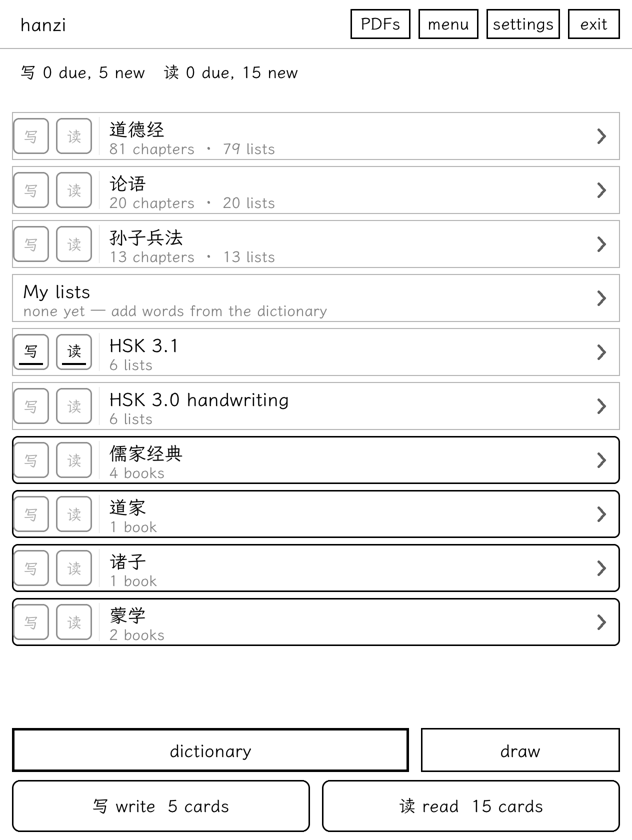
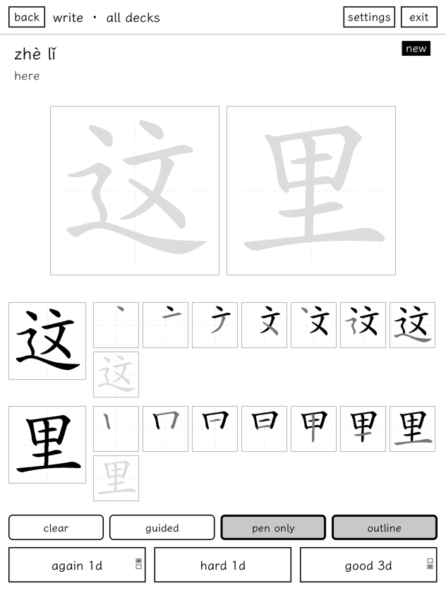
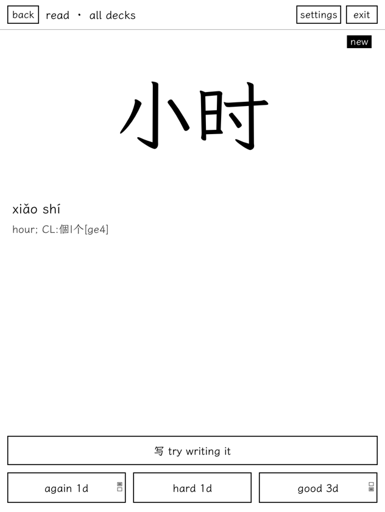
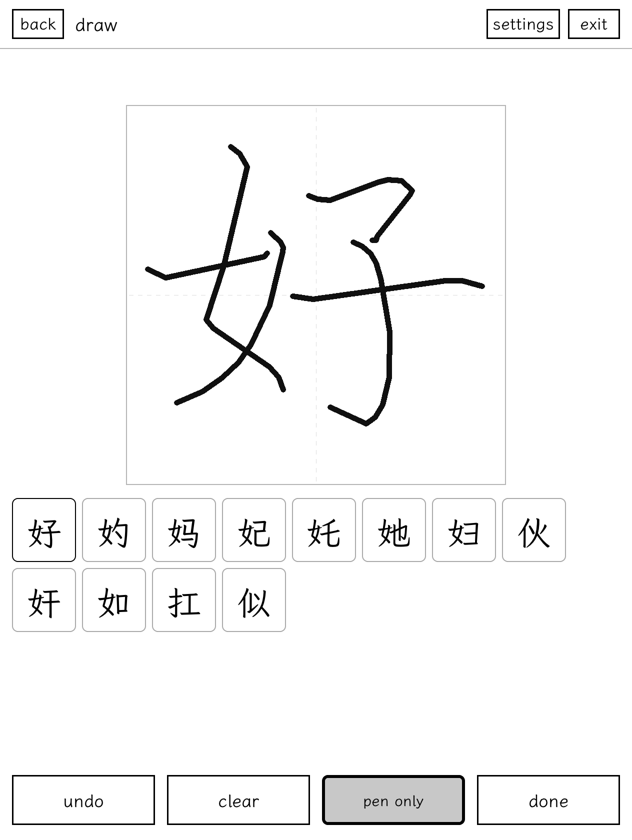
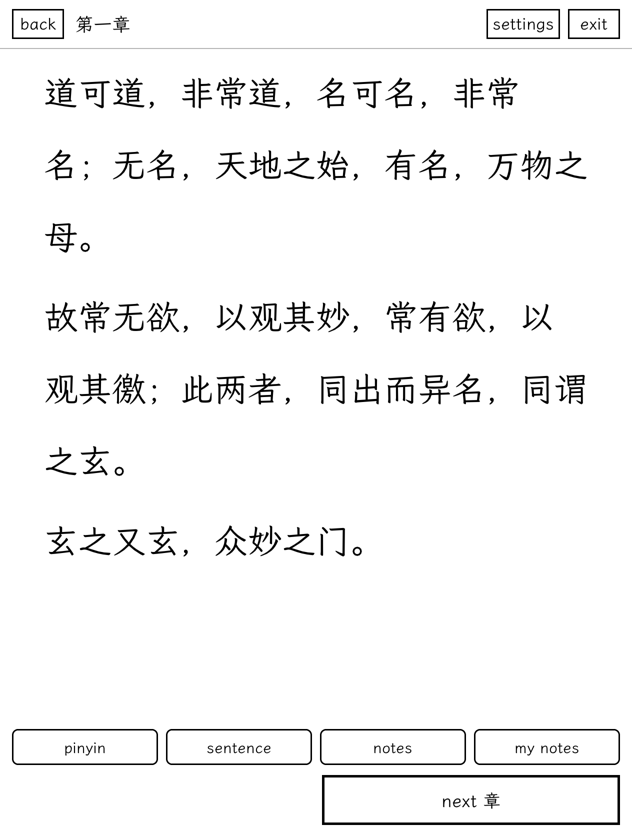
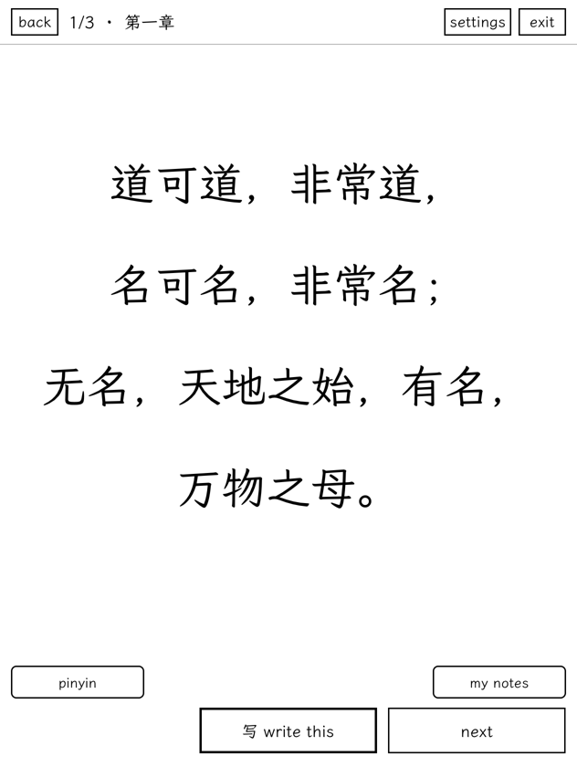

# kobo-hanzi

A Chinese study app for Kobo e-readers (Libra Colour and Clara Colour), written
in C++17. Flashcards with stroke order, handwriting recognition, a dictionary
and a reader, in a single static binary that draws straight to the e-ink
framebuffer. No account, no network.

Designed and directed by me, built with Claude Code.

| | |
|---|---|
|  |  |
|  |  |
|  |  |

## What it does

- **Write and read cards**, scheduled separately with FSRS-5: recognising a
  word and producing it are different skills. A test survives being quit
  half-way; wrong answers come back until they are right.
- **Writing with the stylus**, freehand or guided. The guided mode checks each
  stroke's ends, direction and path against the character's medians and says
  what was wrong.
- **Draw to search**: a drawn character is matched against 9,500 stroke
  signatures on the device.
- **Dictionary**: CC-CEDICT by hanzi, pinyin (with or without tones) or English.
- **Reader**: a chapter at a time, a sentence at a time, or written out by hand;
  each chapter has a deck of the words it introduces.
- **PDFs** through MuPDF, with a press on a scanned character read by PP-OCRv4
  running on ncnn.
- **Pleco** word lists in and out.

Included: the HSK word lists (2025 syllabus, levels 1-6), the 1,200 HSK
handwriting characters, and 道德经, 论语, 孙子兵法, 孟子, 大学, 中庸, 三字经 and
千字文.

## Build

Ubuntu/Debian. MuPDF and ncnn are downloaded (pinned by SHA-256) and built
into `.deps/` the first time, which takes some minutes and about 2 GB.

```sh
sudo apt install g++ make pkg-config libsdl2-dev curl unzip python3
python3 build/build_db.py       # out/content.db, under a minute
make run                        # the desktop build
```

For the Kobo, also `sudo apt install g++-arm-linux-gnueabihf git`, then:

```sh
tools/fetch-deps.sh             # FBInk
make kobo
tools/deploy.sh                 # to a Kobo mounted at /media/$USER/KOBOeReader
```

[NickelMenu](https://pgaskin.net/NickelMenu/) on the Kobo provides the menu
entry that starts it. The deploy script checks every file on the device before
replacing anything. Exit the app before plugging in USB.

## Checks

`tools/check.sh` builds both targets with warnings as errors, runs the unit
tests under AddressSanitizer and UBSan, drives whole study sessions, and draws
the screens at both resolutions through the real hit-testing: a control too
small to press, or one that does nothing, fails.

## How it fits together

```
build/build_db.py        data/ -> content.db (read-only at run time)
src/core/gfx.cpp         software rasteriser into one 8-bit grey buffer
src/core/db.cpp          content.db, and user.db for progress (SQLite)
src/core/srs.cpp         FSRS-5
src/core/match.cpp       stroke matching
src/core/ocr.cpp         PP-OCRv4 on ncnn
src/core/pdf.cpp         MuPDF
src/ui/                  the screens, and the headless test harness
src/backend/mtstate.cpp  multi-touch decoding, testable without hardware
src/backend/surf_fb.cpp  Kobo: FBInk and evdev
src/backend/surf_sdl.cpp desktop: SDL2
```

Both backends show the same buffer, so the desktop build is pixel-identical to
the device and nearly everything can be tested there. Some of what the hardware
taught:

- The panel manages about 8 refreshes a second and the pen reports at 100 Hz:
  every sample is drawn, the refreshes are coalesced.
- Contact is `ABS_MT_TRACKING_ID`; a pen at zero pressure is hovering. Events
  are only acted on at `SYN_REPORT`, since a frame's order is not specified.
- Suspending needs `state-extended` set before `mem`, and must never be tried
  while charging: the kernel hangs.

## Licence

AGPL-3.0-or-later ([LICENSE](LICENSE)), because MuPDF is linked statically.
Other people's code and data are listed in
[THIRD-PARTY-NOTICES.md](THIRD-PARTY-NOTICES.md).
